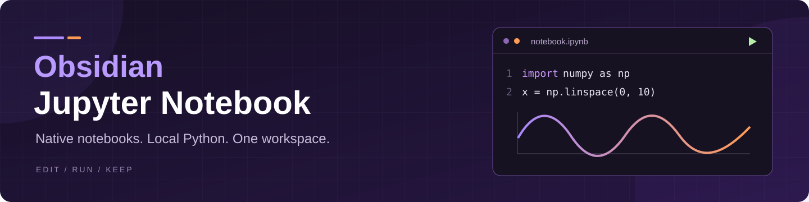

# Jupyter Notebook

<div align="center">
  
  <p><strong>Run Python in Obsidian. Connect notebooks to your knowledge.</strong></p>
  <p>
    <a href="https://github.com/kains2866/obsidian-jupyter-notebook/releases/latest"></a>
    <a href="#installation"></a>
    <a href="#yaml-properties-and-dataview"></a>
    <a href="#platforms-and-execution"></a>
    <a href="https://buymeacoffee.com/kains3772d"></a>
    <a href="https://ifdian.net/a/kains2866"></a>
  </p>
  <p><a href="README.zh-CN.md">简体中文</a> · <strong>English</strong></p>
  <p><a href="#installation">Install</a> · <a href="#quick-start">Quick start</a> · <a href="CHANGELOG.md">Changelog</a> · <a href="#support">Support</a></p>
</div>

---

**Run Python where you keep your notes.** Create and edit `.ipynb` files directly in Obsidian, with Markdown, code, and saved results in the same document.

- **A notebook that belongs in your vault:** editable Properties, backlinks, tags, graph connections, and links to headings and blocks.
- **A complete local workflow:** Python environments, package management, interactive input, execution timing, and rich outputs.
- **A standard file you can keep using elsewhere:** open the same `.ipynb` in Jupyter or VS Code. Properties stay in a Markdown YAML cell; no companion Markdown files are created.

**New in [0.7.0](https://github.com/kains2866/obsidian-jupyter-notebook/releases/tag/0.7.0):** native Properties and notebook indexing, crash-recovery drafts, preserved editing history, and incremental dependency checks. See the [changelog](CHANGELOG.md) for details.

## Documentation

[Features](#features) · [Platforms](#platforms-and-execution) · [Installation](#installation) · [Quick start](#quick-start) · [Environments](#python-environments-and-dependencies) · [YAML & Dataview](#yaml-properties-and-dataview) · [Outputs](#outputs-and-file-saving) · [Limitations](#current-limitations) · [Development](#development-and-verification)

## Features

- **Editable Properties and Dataview**: use YAML in the first Markdown cell to edit properties at the top of the Notebook and query saved values through optional Dataview integration. Aliases containing spaces stay intact.
- **Native notebook connections**: connect saved Markdown cells and YAML links/tags to backlinks, tag search, and the graph; navigate to headings and blocks. Enable **Attachments** in Graph view to see Notebook nodes.
- **Native Notebook editing**: create Code, Markdown, and Raw cells, reorder by dragging, insert inline, and switch cell types. Unaffected cells keep their editors and undo history during structural changes and Markdown mode switches.
- **Local Python execution and input**: run one cell or all cells in a shared kernel, see timing and execution status, interrupt, restart, or reset variables. Answer `input()` below the toolbar; password input is masked, and cancelling interrupts execution.
- **Environments and dependencies**: select an existing Python environment or create a vault-managed environment per device. Search, install, uninstall, and reinstall packages. Incremental checks parse changed cells and show prompts only for missing modules.
- **Rich outputs**: view Markdown tables, sanitized HTML, text, images, and errors. Copy tables as TSV, enlarge images, and save images using Obsidian attachment settings.
- **Recovery and save protection**: restore unsaved drafts after an unexpected shutdown, configure automatic cleanup (7 days by default), and detect external edits before saving.
- **Theme and language integration**: follow Obsidian fonts, sizes, and theme colors; preview embedded Notebook images; choose Chinese, English, or Obsidian's language.

## Platforms and execution

| Use case | Support |
| --- | --- |
| View, edit, and save Notebooks on desktop | Supported |
| Run Python locally on desktop | Supported |
| Mobile | Current releases are desktop-only; mobile viewing belongs to earlier versions |
| Cloud-synced vaults | Files must be accessible locally; each computer uses its own environment |
| Remote Jupyter servers | Not currently supported |

Standalone Python installation has been verified on **macOS Apple Silicon**. Windows and Linux are covered by platform and path tests, but installation has not yet been verified on physical devices running those systems.

## Installation

Current releases are desktop-only. The plugin name is **Jupyter Notebook**, with ID `jupyter-notebook`. Back up the old `obsidian-ipynb` directory and disable it before installing the new plugin. To preserve settings, copy its `data.json` into the new directory while Obsidian is closed. Never enable both versions together. Keep `ipynb-envs/` and `ipynb-runtimes/` intact, then select and validate the local environment again. A standard installation needs only three files; Python helpers are embedded and restored on demand.

For manual installation:

1. Download the individual `main.js`, `manifest.json`, and `styles.css` assets from the [latest Release](https://github.com/kains2866/obsidian-jupyter-notebook/releases/latest).

   Older packages using the `obsidian-ipynb/` directory may require all five files they include. Follow the instructions for that package instead of applying the current three-file layout.
2. Create a `jupyter-notebook` folder containing the three installation files and place it in your vault's `.obsidian/plugins/` directory. If you use a custom configuration directory, replace `.obsidian` accordingly.
3. Confirm that the plugin directory contains these three files:

   ```text
   jupyter-notebook/
   ├── main.js
   ├── manifest.json
   └── styles.css
   ```

4. Reload Obsidian and enable **Jupyter Notebook** under **Settings → Community plugins**.
5. Open or create an `.ipynb` file, then click the Python button in the top toolbar to select an execution environment.

If `.ipynb` files do not appear in the file explorer, enable **Settings → Files and links → Detect all file extensions**. Other plugins that register an `.ipynb` view may conflict with this plugin; enable only one Notebook viewer or editor at a time.

## Quick start

### Create or open a Notebook

You can create a Notebook using any of these entry points:

- The Notebook icon in the left ribbon.
- The **New Jupyter Notebook** action in a folder or file's context menu.
- The **Jupyter Notebook: Create Jupyter Notebook** command in the command palette.

The context menu creates the Notebook in the selected folder or the selected file's parent directory. Other entry points follow Obsidian's new-file location setting. Conflicting names receive a numeric suffix, preserving existing files. Python is not required to create or view a Notebook.

You can also copy the [getting-started example](examples/入门示例.ipynb) into your vault to try code execution, shared variables, and output rendering.

### Select an execution environment

Click the Python button at the top of the Notebook and choose one of these options:

- **Vault-managed environment (recommended)**: download standalone Python 3.12 and install the Notebook runtime components. An existing Python installation is not required.
- **Existing local environment**: select a detected Python, Conda, pyenv, or Jupyter environment, or specify a directory or interpreter path manually.

The list shows each environment's version, dependency status, and whether it is active. Use **Detect environments** to refresh the list. The settings page lets you select the default kernel for Notebooks opened afterward.

### Edit and run cells

| Action | How |
| --- | --- |
| Edit Markdown | Double-click its preview or click the cell's edit icon |
| Preview Markdown | Click the preview icon or press `Shift+Enter` in the editor |
| Run code | Click the run button to the left of the cell or press `Shift+Enter` |
| Run all code cells | Click **Run all** in the top toolbar |
| Save the Notebook | Click the save button or press `⌘/Ctrl+S` |
| Reorder cells | Drag the left gutter outside the Run button, or use the move-up and move-down buttons |
| Add a cell | Hover between cells and choose Code or Markdown |

When editing a long cell, its toolbar stays below the top navigation bar and remains within that cell's boundaries. The editing border, active line, matching brackets, and same-word highlights within the current cell use theme colors. Same-word matching is not Python semantic reference analysis.

## Python environments and dependencies

### Vault-managed environment

Each device has its own Python runtime and virtual environment, stored by default in the vault's configuration directory:

```text
<vault>/<configuration-directory>/
├── ipynb-runtimes/<device-id>/   # Installation tool, standalone Python, and cache
└── ipynb-envs/<device-id>/       # This device's virtual environment
```

The installer uses a pinned official uv release and verifies its SHA-256 checksum. Installation does not modify system Python, the system PATH, or the registry. The device identifier and active interpreter path are stored locally.

After syncing the vault to another computer, create an environment on that computer. Virtual environment binaries from another device cannot be reused directly.

Existing environments can also be used for execution. The bridge environment manages the kernel and requires Python 3.10+ and `jupyter_client`. The execution environment requires `ipykernel` and any third-party packages used by your code. A vault-managed environment installs these components together.

### Install and manage packages

**Manage dependencies** in the environment window operates only on the current device's vault-managed environment. It does not modify system Python or a selected external environment.

- **Search and install**: look up an exact PyPI distribution name, with mappings for common module names such as `sklearn` → `scikit-learn`. This is not a fuzzy search across all of PyPI.
- **Installed**: view packages and versions in the current vault environment. The search field filters only this installed list.
- **Reinstall**: reinstall the current version without reinstalling other dependencies.
- **Uninstall protection**: required Notebook components, their required dependencies, and packages still required by other packages cannot be removed directly.

Installation and uninstallation display stages, progress indicators, and logs. Closing the dependency window cancels the current operation rather than continuing downloads in the background. Completed changes may remain; cancellation does not guarantee a rollback.

An executing kernel prevents environment removal or package changes. Package changes may close idle kernels using that environment; run your code again to restore their variables.

### Dependency checks while editing

After a pause of approximately **900 ms** in code editing, the plugin detects static `import` and `from … import …` statements and checks the Python environment selected for the current Notebook.

Only changed code sources are parsed again; identical sources share parsing results, and removed or replaced historical sources are dropped. Module discoverability is cached for the current interpreter and project directory for up to 45 seconds, then refreshed on the next check. Recheck, environment switches, and closing the dependency window refresh the cache. Hints appear only for missing required or optional modules; other check states stay hidden.

The check does not execute Notebook code, import user modules, or start a Jupyter kernel. It handles aliases, multiline imports, standard-library modules, local modules, and some optional imports. Incomplete syntax does not produce a definitive result.

Missing modules are shown in the relevant code cell, with an action to search for the distribution in the dependency manager. Checks run again after switching environments or closing the dependency window, and can also be triggered using **Recheck**. If you are using an external environment, packages installed in the vault environment do not change that external environment; switch kernels to use them.

Static checks determine only whether a root module is discoverable. They do not guarantee that its internal dependencies or binary extensions work. Dynamic imports and other runtime errors are determined by actual execution. Missing-dependency reminders shown after execution preserve the original error output.

### Sync dependencies and remove environments

Packages explicitly installed through the manager are recorded with pinned versions in `ipynb-requirements.txt` at the vault root. Other devices use this file to restore dependencies when creating an environment. An existing `requirements.txt` is not overwritten; its project dependencies are also installed during environment creation.

The managed requirements file accepts only exact package names, pinned versions, and comments—not pip options, paths, or URLs. If a package operation succeeds but writing the requirements file fails, the plugin reports the failure without automatically rolling back the completed installation or removal.

**Delete** in the environment list requires a second confirmation and removes only the current device's environment after verifying its ownership. Notebooks, other devices' environments, and requirements files are preserved. Uninstalling the plugin does not automatically remove its environments. To clean up completely, delete the vault environment through the plugin first.

## YAML properties and Dataview

Add YAML at the start of the first Markdown cell:

```yaml
---
title: My Notebook in Obsidian
aliases:
  - My Notebook
tags:
  - Python
  - Notebook
status: Learning
---
```

Version 0.7.0 includes a native Properties editor at the top of the Notebook. It reuses Obsidian's property types and controls, writes edits to the Markdown YAML through the normal save/undo flow, and creates a Markdown cell if none exists. If the internal component is unavailable, it falls back to a read-only preview. Invalid YAML must be fixed in the Markdown source first. Editing properties reserializes YAML, so comments and quoting may change; nested values remain available in YAML source. This does not add core File properties sidebar or Bases indexing.

After saving, the properties can be queried by an enabled Dataview plugin. For example, add this to a Markdown cell or a regular note:

````markdown
```dataview
TABLE title AS "Title", status AS "Status"
FROM #Python
```
````

Markdown previews style HTML `div` containers and Jupyter-style `alert` blocks with theme-aware backgrounds and borders. Success, information, warning, and danger variants use the current theme colors.

Markdown cell previews can display query results. The plugin provides an in-memory adapter for indexing Notebook properties. It does not modify Obsidian's core metadata cache or the core File properties sidebar. The Dataview adapter relies on internal interfaces and has been verified with **0.5.68**. If incompatible, it reports the issue and safely skips indexing.

Notebooks retain standard nbformat structure, including unknown metadata and fields. When opened in Jupyter or VS Code, YAML remains ordinary Markdown content and does not affect Python execution. Dataview queries work only in an Obsidian environment with Dataview enabled.

## Theme typography and embedded attachments

Notebook text, code, line numbers, and interface labels follow Obsidian’s font and size variables. Theme and font changes apply through CSS without replacing editors or clearing undo history.

Markdown cells can preview their own `attachment:` images (PNG, JPEG, GIF, WebP, and sanitized SVG), including encoded filenames. Attachments remain inside the `.ipynb`; previews do not extract or rewrite them. Missing, damaged, and unsupported attachments display a short explanation. SVG scripts and automatic external resource loads are filtered. Temporary preview URLs are released when cells are recycled, modes change, or the document closes. Paste images at the Markdown editor cursor or drop them at a chosen position; dropping onto a preview appends and opens editing. Multiple images are supported, names are numbered on collisions, and attachments and references undo/redo together. Images stay inside the standard `.ipynb` without external vault files. SVG is sanitized before insertion. Limits are 20 MiB per image and 50 MiB per insertion; Code and Raw cells do not accept images.

## Native links and navigation

Saved Markdown cells and YAML tags/links participate in native backlinks, tags, search, and graph relationships. Enable **Show attachments** in Obsidian graph settings to display Notebook nodes and their connections. Code and execution output are excluded. Heading and block links navigate to the corresponding Markdown cell.

The index uses an in-memory Markdown projection without companion files. Native bulk property/task writers are excluded. Renaming or moving a linked note, attachment, or folder through Obsidian updates indexed Markdown links and the first Markdown cell’s YAML links, using Obsidian’s own link resolution, link format, and automatic-update preference or confirmation dialog. Aliases, heading/block suffixes, code, output, attachments, and unknown Notebook fields are preserved. Open notebooks retain unsaved changes in other cells and Notebook undo history. Updates are skipped with a notice if a referenced cell has unsaved edits, the file changed externally, or the session is loading, running, or saving; update those links manually. Typing during a rename write is retained and later saves wait for the new disk baseline. If the linked cell changes during that write, its live edits remain intact and a notice asks you to check its links. External filesystem renames are outside this native rename workflow. Compatibility depends on internal Obsidian interfaces and is checked at runtime.

## Outputs and file saving

### Offline HTML export

Choose **More actions → Export as HTML** to download one self-contained HTML file from the current notebook, including unsaved edits, Markdown, code, raw cells and stored static outputs. This does not run code, start Python, or save the original notebook. The browser may ask where to save the file; canceling that dialog leaves no exported file.

Cell attachments and resolvable vault images are embedded. Remote images are never downloaded; missing or unsupported images retain alternative text. HTML and SVG are sanitized, with no automatically loaded external scripts, stylesheets, or fonts. Formulas retain readable LaTeX source, and interactive widgets are exported as available static/text content. Obsidian-specific plugin processors are not run during export.

Supported outputs include text, PNG/JPEG images, static Markdown, sanitized HTML tables, and errors. Settings provide output collapsing, clearing, size warnings, and optional limits.

- Long text and table outputs collapse at 600 px by default. Images start expanded and can be collapsed manually; expand/collapse controls appear only when needed.
- Images load near the viewport. Documents with recycling enabled release distant display nodes; original outputs remain stored in the Notebook.
- Text can be copied and tables preferentially copy as TSV. Images can be enlarged or saved through Obsidian attachment settings, retaining provided filenames or using numbered fallbacks for unnamed images.
- Default warnings appear when cell outputs reach 50 MiB or Notebook outputs reach 200 MiB.
- Hard limits, automatic removal of old outputs, and releasing undo history when clearing outputs are disabled by default.

Output limits measure serialized data size, not Obsidian's total memory usage. Offscreen editor and output recycling is supported. Clearing outputs does not clear kernel variables; saving writes the cleared outputs to the file.

The plugin supports explicit saving and saving on close. It does not write to disk after every keystroke. Before saving, it checks for external changes and refuses to overwrite conflicting content. If saving the original file on close fails, it attempts to write an `.ipynb` recovery copy and notifies you.

HTML/SVG outputs filter scripts, active embeds, unsafe links, and automatic remote resources. Markdown outputs use a separate static parser without Obsidian plugin processors. When content is filtered, a collapsed **Some output was filtered** explanation lists the reasons; it does not indicate execution failure. Regular Markdown cells retain Obsidian native rendering.

### Local recovery and incremental rendering

Unsaved changes are checkpointed roughly once per second in the device user's `.cache/obsidian-jupyter-notebook/recovery/` directory, separately by vault, file, and view. Reopening a Notebook offers to restore a draft into the editor without directly overwriting the original file. Successful saves clean up the corresponding draft; damaged and declined drafts remain available until they expire. The most recent edits not yet written at a crash may still be lost. Local recovery is not a separate backup.

Settings → Cache and recovery provides a retention period (1–365 days, default 7), an Open cache directory action, and Clean expired cache. Drafts and temporary files expire based on their last modification time. Checks run at startup, when opening a Notebook, and hourly while Obsidian is running. Active sessions are protected; permission failures and uncertain session states are skipped and reported. No cleanup runs while Obsidian is closed.

Offscreen recycling considers cell count, source/output size, image count, and estimated document height. Active editing, running, and interacting cells remain mounted. Markdown mode changes and cell structure operations reuse unaffected editors and their undo state where possible.

## Current limitations

- Code editing and execution currently target Python. Remote kernels are not supported.
- Notebook widgets and active JavaScript outputs are not supported. Static SVG within HTML output is filtered for safety; inline stdin prompts are supported.
- Embedded attachment preview supports PNG, JPEG, GIF, WebP, and sanitized SVG; other MIME types are preserved without preview.
- Native Notebook indexing uses guarded internal Obsidian interfaces. If unavailable, editing and execution remain available. The core File properties sidebar and Bases are not integrated.
- Cell types follow the file's `cell_type` field rather than being inferred from content. HTML callouts incorrectly marked as code can be changed to Markdown manually.
- Special third-party theme styles written exclusively for the native reading view may require additional adaptation.

## Development and verification

The project uses TypeScript, CodeMirror 6, and esbuild. The Python bridge uses `jupyter_client` and `ipykernel`.

The complete development workflow below applies to macOS/Linux. Some Node tests invoke the project's `.venv/bin/python`, so prepare the Python test environment before running the tests:

```bash
npm ci
python3 -m venv .venv
.venv/bin/python -m pip install jupyter_client ipykernel
npm test
npm run test:coverage
npm run typecheck
npm run build
.venv/bin/python -m unittest discover -s tests -p 'test_*.py'
```

Build outputs are written to `dist/`, including the three standard files required for store installation (the optional standalone Python helper copies are also built).

On Windows, Python unit tests can use `.venv\Scripts\python.exe`. Some Node kernel and integration tests still use Unix paths and require adaptation before running.

UI and integration verification scripts:

```bash
node tests/preview-server.mjs
# Run in another terminal:
node tests/ui.e2e.cjs
node tests/interactions.e2e.cjs
node tests/outputs.e2e.cjs
node tests/toolbar-layout.e2e.cjs
node tests/mobile-bundle.cjs
node tests/node-imports.cjs
```

The end-to-end scripts require Playwright. Set `PLAYWRIGHT_MODULE` to specify its module path. The offline environment creation test is `tests/vault-environment.integration.mjs`; the local pip cache must contain the required installation packages.

The real Obsidian test on macOS is `tests/obsidian.e2e.cjs`, which uses a separate temporary vault and configuration directory. Quit your regular Obsidian instance normally before running it to prevent multiple instances from sharing the CLI socket. The test stops if it detects an existing connection.

## Version history

See [CHANGELOG](CHANGELOG.md) for feature changes and [GitHub Releases](https://github.com/kains2866/obsidian-jupyter-notebook/releases) for published packages. Early archive commits do not imply that a complete source snapshot exists for each historical version.

## Support

If this plugin makes your Notebook workflow easier, you can support its continued development. Bug reports and shared feedback are also welcome.

<p align="center">
  <a href="https://buymeacoffee.com/kains3772d"></a>
  <a href="https://ifdian.net/a/kains2866"></a>
</p>

<details>
<summary><strong>Support via WeChat Pay or Alipay</strong></summary>

Thank you for your support. Scan the appropriate original payment code below. Donations do not unlock additional features and are not required to use the plugin.

<table>
  <tr>
    <th align="center">WeChat Pay</th>
    <th align="center">Alipay</th>
  </tr>
  <tr>
    <td align="center"></td>
    <td align="center"></td>
  </tr>
</table>

</details>

<p align="center"><sub>Created by <a href="https://github.com/kains2866">Kains</a> · Obsidian Jupyter Notebook</sub></p>

## Permissions and network access

Desktop execution inspects local interpreters and device-specific environment directories, and starts Python, pip, and installation-tool processes without enabling a shell. These permissions are required to run notebooks and manage environments. Run only notebooks you trust. Installation starts on explicit user action; the tool archive is checked against its pinned SHA-256. Synced managed requirements allow only validated package names and pinned versions, not arbitrary paths or URLs. Package queries use the Obsidian request transport. Cancellation stops waiting promptly, but that transport cannot abort an already-issued network request. uv downloads retain Electron streaming for progress, cancellation, and size limits.

## Release maintenance

Run `npm run release:version -- X.Y.Z` (replace `X.Y.Z` with a version greater than all existing versions) once for a new version; it updates package/lock, manifest, compatibility history and adds a changelog section without overwriting an existing release. Fill in that section before publishing. `npm run release:preflight` checks metadata, tests, lint, types and the build (Python integration tests require `.venv` with `jupyter_client` and `ipykernel`). PRs and main run the same preflight.

`npm run release:package` builds `release/` with `main.js`, `manifest.json`, `styles.css`, a direct-install ZIP containing `jupyter-notebook/`, `SHA256SUMS`, and release notes extracted from the current changelog section. Copy the three files into `.obsidian/plugins/jupyter-notebook/`, or extract the ZIP into `.obsidian/plugins/`. The tag workflow tests and builds, then uploads and attests only `main.js`, `manifest.json`, and `styles.css`. ZIP and SHA256SUMS remain local and are not uploaded to GitHub Releases. Historical run re-runs still use their original workflow; dispatch the latest workflow from main with the target tag for a manual rebuild. Existing release titles and notes are preserved.

Large-notebook regression tests cover scrolling, editing, undo, and resource release in specific scenarios; they do not guarantee all scrolling or memory issues are resolved.
